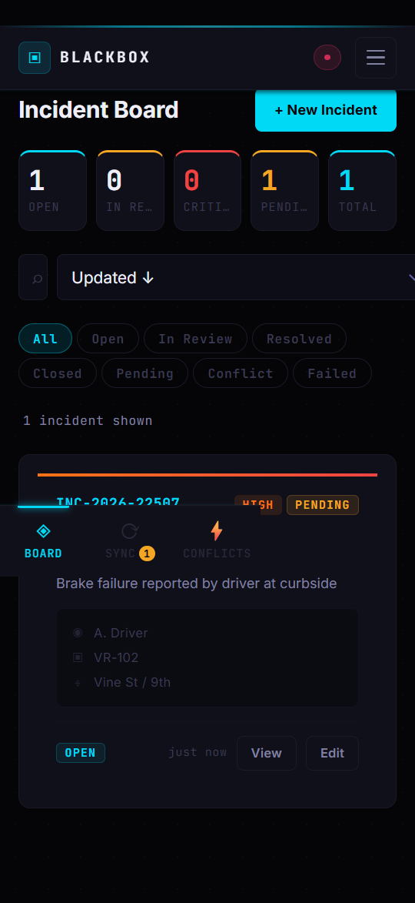
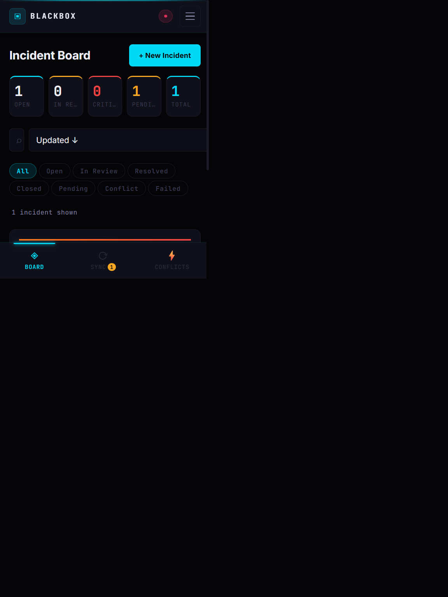
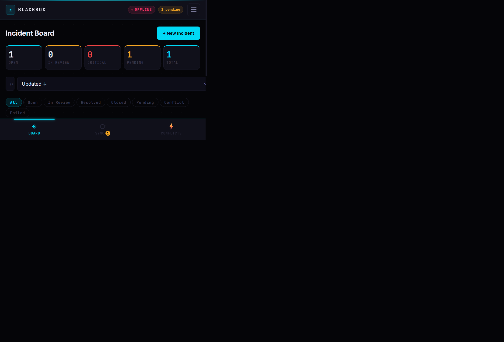

# BLACKBOX — Offline-First Sync for an Emerging Ride-Hailing Startup

## Scope statement
This project addresses the operational needs of an emerging ride-hailing startup that must continue recording driver incidents, route disruptions, passenger safety issues and vehicle problems even when internet coverage is weak or unavailable. The app is scoped to a single incident entity, local-first storage, automatic retry, and conflict resolution when two devices update the same record while offline.

The deliverable focuses on one business problem: a field agent or dispatcher should be able to create or revise an incident in a browser without a network connection, then safely synchronize once connectivity returns.

---

## Why this project matters
Real-world ride-hailing operations cannot rely on a stable mobile connection. Drivers move through tunnels, rural zones and dense urban corridors where network outages are common. If the app fails when offline, the company loses incident intelligence at the exact moment it is most important.

BLACKBOX solves that by treating offline mode as a first-class operating state rather than an edge case.

---

## What I built
- Offline-first incident capture and editing in the browser
- IndexedDB persistence for incidents, sync queue and conflict logs
- Sync queue with retry attempts and failed-item tracking
- Manual and automatic sync triggers when the connection returns
- Conflict detection for simultaneous offline edits on the same incident
- Deterministic last-write-wins resolution with audit logging
- Mobile-first UI scaled up for tablet and desktop screens

---

## Key technical decisions

### 1. Local-first data model
The primary entity is an Incident record. Each record includes:

| Field | Purpose |
|---|---|
| id | Stable local/global record ID |
| incidentCode | Human-readable reference code |
| rideId | Related ride or trip ID |
| incidentType | Collision, breakdown, dispute, theft, etc. |
| severity | Low, medium, high, critical |
| description | Operational narrative |
| driverName | Driver reporting the event |
| vehicleId | Assigned vehicle |
| location | Where the event occurred |
| status | open, in review, resolved, closed |
| version | Server-assigned version used for conflict checks |
| updatedAt | Timestamp used for time ordering |
| deviceId | Source device used in tie-break logic |
| syncStatus | pending, syncing, synced, failed |

### 2. Conflict rule
BLACKBOX uses Last-Write-Wins based on `updatedAt`.

| Condition | Winner | Rule |
|---|---|---|
| local.updatedAt > server.updatedAt | local | LWW |
| server.updatedAt > local.updatedAt | server | LWW |
| timestamps equal | lexicographically greater deviceId | deterministic tie-break |

This is documented in the app and is intentionally simple, explicit, and auditable.

### 3. Why this rule was chosen
For a portfolio-grade offline sync feature, deterministic, testable behavior matters more than perfect conflict semantics. The project intentionally prioritizes:
- clear logic
- easy debugging
- predictable outcomes
- auditability in the conflict log

The known limitation is clock skew: a device with a faster clock may win even when the actual edit order differs. This is noted openly in the project documentation.

---

## Offline sync flow
1. User creates or edits an incident while offline.
2. The data is written immediately to IndexedDB.
3. A sync queue entry is created with operation metadata (`create`, `update`, `delete`), payload and status.
4. When connectivity returns, the app calls the sync engine.
5. The queue is processed in order.
6. If the server rejects the request with 409 conflict, the client resolves it locally using the LWW rule.
7. The conflict record is logged to the conflict log store and the winning payload is persisted.
8. The app refreshes the local board and the server’s accepted state.

---

## Test and validation evidence
I validated the project with both automated and browser-level checks.

| Check | Result |
|---|---|
| Conflict resolver unit tests | 14 passed, 0 failed |
| Frontend production build | Successful Vite build |
| Backend health check | Successful API response |
| Browser smoke test | Incident created and appeared in the board |
| Sync queue validation | Pending item created correctly |

Command evidence:
- `cd client && node src/sync/conflictResolver.test.mjs`
- `cd client && npm run build`
- `curl http://localhost:5000/api/health`

### Problems found and fixed
- Initial service worker/offline setup required a production preview test rather than dev mode.
- MongoDB needed to be started manually from the local binary because the Windows service could not start cleanly.
- During browser validation, the app was confirmed to keep the record local when offline and mark it as pending sync.

---

## Screenshots
Below are screenshots captured at the required mobile-first breakpoints.

### Mobile — 360px

### Tablet — 768px

### Desktop — 1440px

Additional evidence screens captured during development:
- [screenshots/dashboard.png](./screenshots/dashboard.png)
- [screenshots/conflict_log.png](./screenshots/conflict_log.png)
- [screenshots/offline.png](./screenshots/offline.png)
- [screenshots/new_incident.png](./screenshots/new_incident.png)
- [screenshots/sync_queue.png](./screenshots/sync_queue.png)

---

## Files and structure
- `client/src/db/indexedDB.js` — IndexedDB schema and transaction helpers
- `client/src/db/incidents.js` — incident CRUD in local storage
- `client/src/db/syncQueue.js` — queue lifecycle and retry logic
- `client/src/sync/syncEngine.js` — outbound sync and conflict handling
- `client/src/sync/conflictResolver.js` — deterministic merge and conflict resolution
- `server/src/index.js` — Express API entry point
- `server/src/routes/incidents.js` — incident endpoints

---

## Limitations and future improvements
- The project uses client-generated timestamps; if clocks are skewed, result ordering may be inaccurate.
- Deletes are not yet as fully modeled as edits in the conflict lifecycle.
- A real production system would add stronger server-side versioning, retry backoff and authentication.
- Background Sync support is browser-dependent and supplementary rather than universal.

---

## Changelog
### v0.5.0
- Added IndexedDB-backed offline incident storage
- Added sync queue processing and retry handling
- Added conflict detection and LWW resolution
- Added mobile-first layouts and responsive views
- Added project evidence screenshots and documentation

### v0.4.0
- Initial backend API and incident routes
- Initial frontend incident board and form

---

## Final summary
BLACKBOX is a working offline-first incident management app for an emerging ride-hailing startup. It demonstrates the core skills required for real-world sync systems: local-first saves, catch-up sync, queued retries, deterministic conflict handling, and evidence-driven validation.

The project is intentionally scoped and practical: not a generic demo, but a credible portfolio piece that a hiring manager can understand, inspect and trust.
