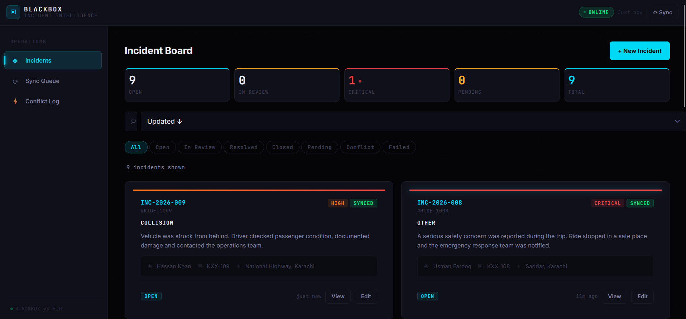
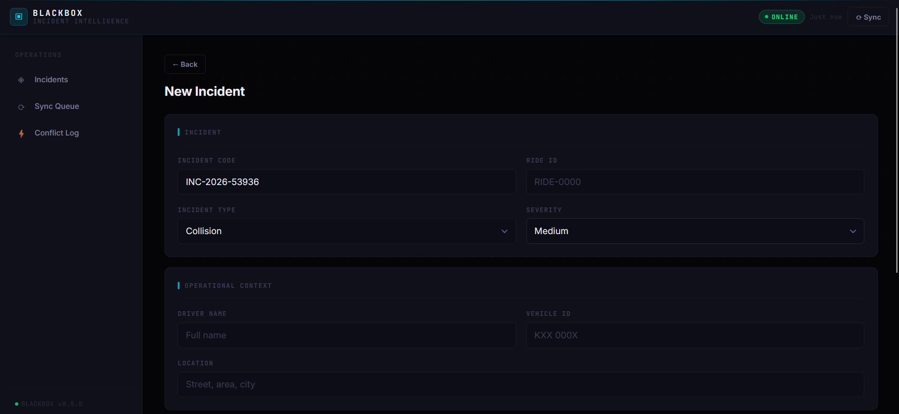
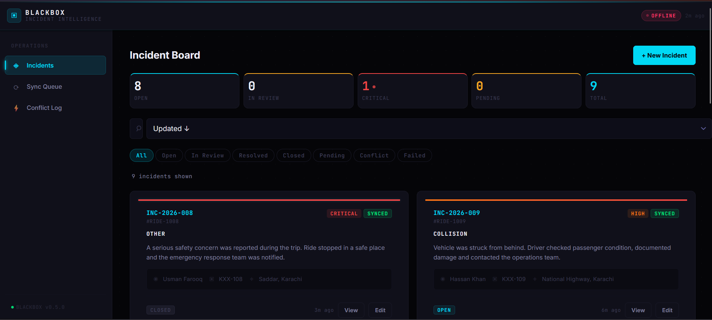
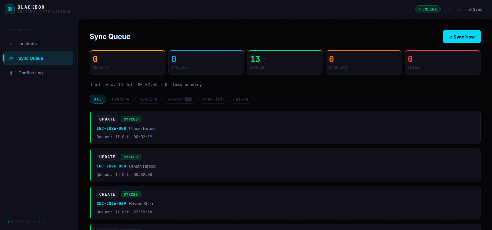
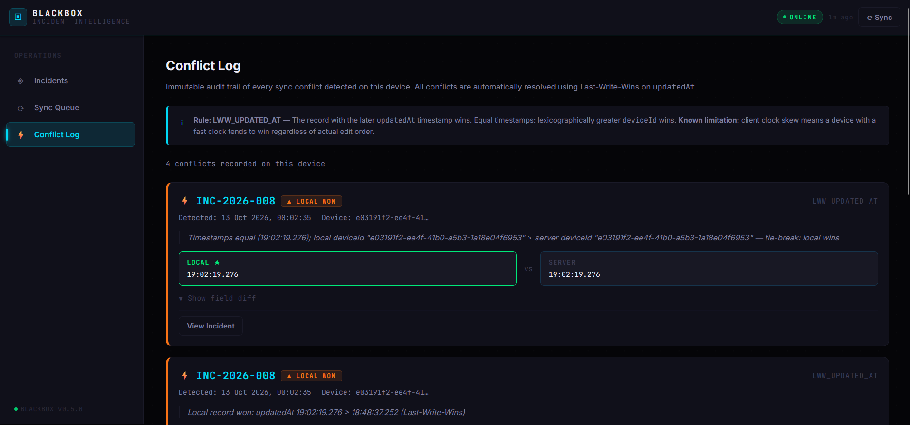

# BLACKBOX — Offline-First Incident Sync

An offline-first incident management application for an emerging ride-hailing startup. BLACKBOX allows field agents and dispatchers to record and update operational incidents even when internet connectivity is unavailable, then synchronize changes when the connection returns.

## Project Overview

Ride-hailing operations depend on timely reporting of driver incidents, route disruptions, passenger safety issues, and vehicle problems. Unreliable internet connectivity should not prevent teams from capturing critical information.

BLACKBOX addresses this problem through local-first storage, a persistent sync queue, automatic retry handling, and deterministic conflict resolution.

**Core objective:** Let users create and edit incidents offline, preserve their data locally, and synchronize it reliably when connectivity is restored.

## Features

- Offline-first incident creation and editing
- IndexedDB persistence for incidents, sync queue, and conflict logs
- Persistent synchronization queue with retry and failure tracking
- Manual and automatic sync triggers when connectivity returns
- Conflict detection for simultaneous offline edits
- Deterministic Last-Write-Wins (LWW) conflict resolution
- Audit logging for conflict decisions
- Responsive interface for mobile, tablet, and desktop
- Incident status and synchronization tracking

## Screenshots

The following screenshots are stored in the `screenshots/` directory and provide visual evidence of the application's interface and functionality.

### Dashboard



### Create Incident



### Offline Mode



### Sync Queue



### Conflict Log



## Technology Stack

- **Frontend:** React, Vite, JavaScript
- **Local storage:** IndexedDB
- **Backend:** Node.js, Express
- **Database:** MongoDB
- **Synchronization:** Persistent queue, retry handling, and conflict resolution
- **Version control:** Git and GitHub

## How Offline Sync Works

1. A user creates or edits an incident while offline.
2. The application saves the incident locally in IndexedDB.
3. A sync queue entry records the operation, payload, and status.
4. When connectivity returns, the synchronization engine processes queued operations.
5. If the server reports a conflict, the client applies the documented resolution rule.
6. The conflict and resolution are recorded in the conflict log.
7. The local incident board is refreshed with the resulting state.

## Data Model

The primary entity is an **Incident** record.

| Field | Purpose |
|---|---|
| `id` | Stable record identifier |
| `incidentCode` | Human-readable incident reference |
| `rideId` | Related ride or trip |
| `incidentType` | Incident category |
| `severity` | Low, medium, high, or critical |
| `description` | Incident details |
| `driverName` | Reporting driver |
| `vehicleId` | Assigned vehicle |
| `location` | Incident location |
| `status` | Open, in review, resolved, or closed |
| `version` | Version used for conflict checks |
| `updatedAt` | Timestamp used for ordering updates |
| `deviceId` | Source device identifier |
| `syncStatus` | Pending, syncing, synced, or failed |

## Conflict Resolution Strategy

BLACKBOX uses **Last-Write-Wins (LWW)** based on the `updatedAt` timestamp.

| Condition | Winning update |
|---|---|
| Local timestamp is newer | Local update |
| Server timestamp is newer | Server update |
| Timestamps are equal | Lexicographically greater `deviceId` |

This approach provides predictable, deterministic, and auditable outcomes for concurrent edits.

**Known limitation:** Client-generated timestamps can be affected by clock skew. A device with an inaccurate clock may cause an update to win even when it was not the last real-world edit.

## Testing and Validation

The project was validated through automated tests and browser-level checks.

| Validation | Result |
|---|---|
| Conflict resolver unit tests | 14 passed, 0 failed |
| Frontend production build | Successful |
| Backend health check | Successful API response |
| Browser smoke test | Incident created and displayed |
| Offline queue validation | Pending sync item created correctly |

### Validation Commands

Run the conflict resolver tests:

```bash
cd client
node src/sync/conflictResolver.test.mjs
```

Build the frontend:

```bash
cd client
npm run build
```

Check the backend health endpoint while the server is running:

```bash
curl http://localhost:5000/api/health
```

### Issues Addressed

- Tested offline behavior using a production preview rather than relying only on development mode.
- Started MongoDB manually when the Windows service did not start correctly.
- Verified that incidents remain available locally while offline and are marked as pending synchronization.

## Project Structure

```text
BLACKBOX/
├── client/
│   └── src/
│       ├── db/
│       │   ├── indexedDB.js
│       │   ├── incidents.js
│       │   └── syncQueue.js
│       └── sync/
│           ├── syncEngine.js
│           └── conflictResolver.js
├── server/
│   └── src/
│       ├── index.js
│       └── routes/
│           └── incidents.js
├── docs/
├── screenshots/
├── .gitignore
├── CHANGELOG.md
└── README.md
```

## Limitations and Future Improvements

- Improve timestamp reliability and server-side version management.
- Extend conflict handling for delete operations.
- Add stronger authentication and authorization.
- Introduce configurable retry backoff for failed synchronization.
- Improve support for browser-dependent Background Sync functionality.
- Add more extensive integration and multi-device synchronization tests.

## Changelog

### v0.5.0

- Added IndexedDB-backed offline incident storage.
- Added sync queue processing and retry handling.
- Added conflict detection and LWW resolution.
- Added responsive interface layouts.
- Added project screenshots and documentation.

### v0.4.0

- Added the initial backend API and incident routes.
- Added the initial incident board and form.

## Summary

BLACKBOX demonstrates a practical approach to offline-first application design through local persistence, queued synchronization, retry handling, and deterministic conflict resolution.

The project focuses on a real operational challenge in ride-hailing services: ensuring that important incident information can still be recorded when connectivity is unreliable.

**Repository:** [BLACKBOX on GitHub](https://github.com/syeda-ajiya56/BLACKBOX)
